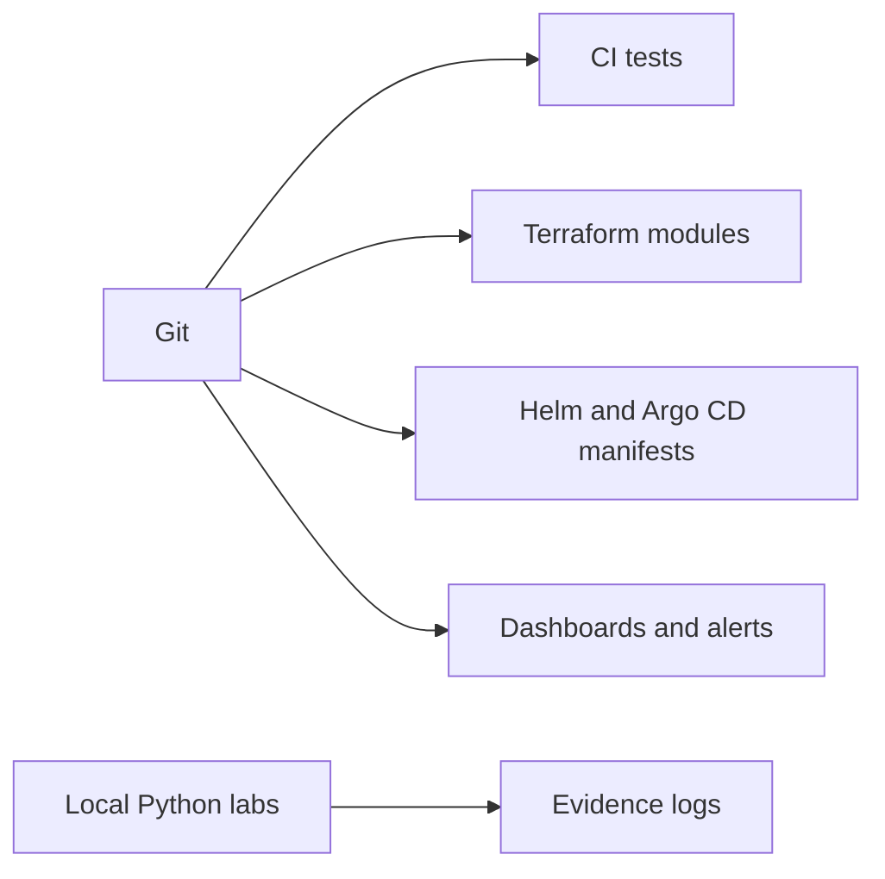

# DevOps engineering portfolio

Public practice repository for entry-level DevOps, cloud, platform, and SRE interviews. The projects are real files with local tests. They are not a production platform, and this repository was not applied to an AWS account.

Author: Mayank Rai. Portfolio remote: [github.com/maynk1013/certificatee](https://github.com/maynk1013/certificatee).

## Projects

| Project | What is in the folder | Local check | Not done |
| --- | --- | --- | --- |
| [01 GitOps EKS](projects/01-gitops-eks-platform/README.md) | Terraform VPC, IAM, and EKS modules, demo app, Helm, Argo CD, Prometheus rules | pytest, Helm, Terraform validate | EKS apply, image scan |
| [02 Progressive delivery](projects/02-progressive-delivery/README.md) | Argo Rollouts chart and a local blue-green/canary model | pytest rollout decisions and Helm render | Live cluster rollout |
| [03 Multi-environment Terraform](projects/03-terraform-multi-environment/README.md) | Dev, staging, and prod-style roots over shared modules | tag policy, validate, invalid fixture fails | S3 lock against a real bucket |
| [04 Observability](projects/04-observability-platform/README.md) | Dashboards, alert rules, Loki and Alloy values, local query lab | pytest alert scenario | Grafana/Loki install |
| [05 Cost reporter](projects/05-aws-cost-optimizer/README.md) | Dry-run findings from synthetic inventory | pytest, sample report with null savings | Live AWS inventory |
| [06 Disaster recovery](projects/06-disaster-recovery/README.md) | Backup policy, manifests, synthetic restore drill | checksum restore and Terraform validate | AWS restore, cross-region |
| [07 Secrets](projects/07-secrets-management/README.md) | Provider-based secret read and local rotation | log redaction and rollback tests | Real Secrets Manager secret |

## Stack

Terraform 1.14.x, Helm, Kubernetes manifests, Python 3.12+, GitHub Actions, and GitLab CI. Optional AWS services are EKS, S3 state, Backup, and Secrets Manager. Docker, kind, Trivy, and Checkov were not required for the checks that passed on the authoring machine. The verification section below is updated from the commands that were actually run.

## Architecture

[docs/architecture/overview.md](docs/architecture/overview.md)



## Setup

From this repository root:

```bash
python3 -m venv .venv
source .venv/bin/activate
pip install -r requirements-dev.txt
pytest -q
```

Terraform and Helm:

```bash
bash scripts/validate-all.sh
```

`validate-all.sh` does not call `terraform apply` and does not use AWS credentials.

## Resume and interview notes

- [docs/resume/devops-projects.md](docs/resume/devops-projects.md)
- [docs/resume/resume-bullets.md](docs/resume/resume-bullets.md)
- [docs/resume/Mayank_Rai_DevOps_Resume.pdf](docs/resume/Mayank_Rai_DevOps_Resume.pdf)
- [docs/interview-preparation/README.md](docs/interview-preparation/README.md)
- [docs/portfolio-roadmap.md](docs/portfolio-roadmap.md)

The PDF is one page and uses normal text, not an image. A commercial ATS product was not used to score it. Do not quote a numeric ATS score from this repository.

## Verification

Run on 23 October 2026 from this repository root on macOS, with Terraform 1.14.7, Helm 4.1.1, and Python 3.14.5. AWS provider lock resolved to 5.100.0. No AWS account was used.

| Command | Result |
| --- | --- |
| `.venv/bin/pytest -q` | 40 passed |
| `python tools/secret_scan.py` | no matched patterns |
| `terraform fmt -check -recursive projects` | passed |
| `terraform validate` on the six root modules | passed |
| invalid VPC fixture validate | failed as expected, because `cidr_block` was a number |
| `helm lint` on both charts | 0 charts failed. Helm printed an info note that an icon is recommended |
| resume PDF render | 1 page, text is stored as PDF text operators |

Not run on this machine, so not claimed: Docker build, Trivy image scan, kind or k3d, Checkov, a live Argo CD sync, Grafana or Loki install, Slack delivery, and any `terraform apply`. GitHub Actions and GitLab CI files are present and were not executed here. The local restore drill recorded about 0.0005 seconds for a synthetic file copy. That is not an AWS recovery time. The sample cost report has 5 findings and no savings figure.

## Limits

No measured uptime, deployment frequency, cost saving, or cloud recovery time is claimed. RPO and RTO in project 6 are targets. Slack webhooks are optional and empty. Cross-region backup is off.
