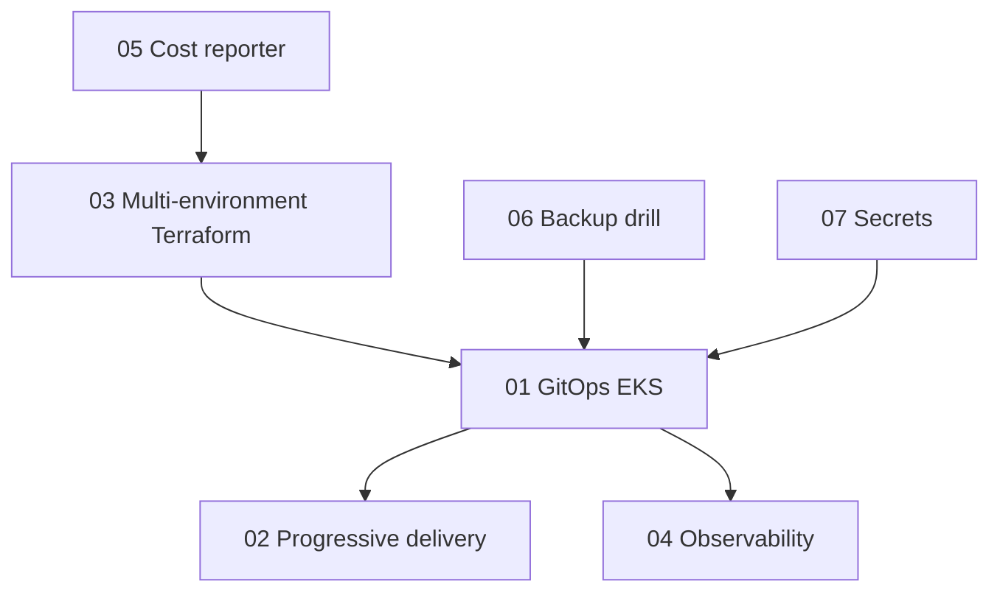

# Portfolio architecture

The seven projects are independent folders. They share ideas, not a single runtime. A recruiter can open one project without installing the others.

What was exercised on this machine is recorded in the root README after the validation commands. AWS apply, image push, and a live Kubernetes install were not part of that run.

## Hinglish

Pehle network aur permissions ka design aata hai, phir application, phir usko safely release karna, phir usko dekhna, phir paise aur backup, aur last mein secret. Isliye folders ka number bhi yahi order follow karta hai. Har folder apna test khud chalata hai.
