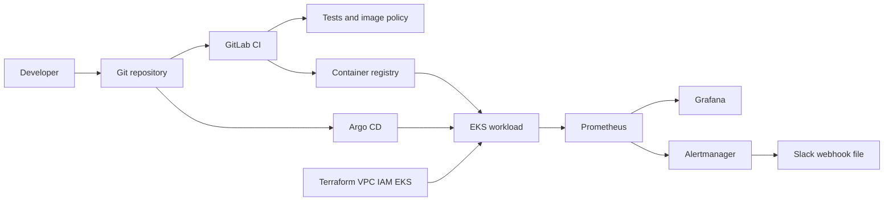

# Project 1 — GitOps platform for Amazon EKS

This project is a local, reviewable design for a small Kubernetes platform. It contains Terraform modules for a VPC, IAM roles, and an EKS cluster, a sample web application, a Helm chart, Argo CD application manifests, Prometheus rules, a Grafana dashboard, and an Alertmanager Slack example.

No EKS cluster was created from this repository during development. `terraform apply` is not part of the default workflow.

## Samajh lo, Hinglish mein

Socho ek shop hai. Terraform us shop ki building banata hai: network (VPC), lock aur keys (IAM), aur Kubernetes cluster (EKS). Building banana aur uske andar application rakhna alag kaam hai.

Application ko Docker image mein pack karte hain. Helm us image ko Kubernetes Deployment, Service, probes, aur resource limits ke roop mein likhta hai. Argo CD Git repository ko source of truth maanta hai. Jab tum Git mein chart change karte ho, Argo CD cluster ko usi state par le aane ki koshish karta hai. Isi ko GitOps kehte hain.

Prometheus numbers collect karta hai, jaise kitne requests aaye aur kitne fail hue. Grafana un numbers ko dashboard par dikhata hai. Alertmanager tab message bhej sakta hai jab rule match ho. Slack webhook is repo mein hardcoded nahi hai. URL ek file se aata hai, jo tum secret mein rakhoge.

## Architecture



Deployment flow, jab tum baad mein real AWS use karo:

1. Terraform se VPC, IAM, aur EKS banega. Yeh step abhi run nahi hua.
2. CI application tests chalata hai. Registry credentials hon tab image push hota hai.
3. Helm values mein image tag change hota hai aur Git mein commit hota hai.
4. Argo CD `dev-demo-web` application ko sync karta hai.
5. Kubernetes readiness probe `/readyz` pass hone ke baad traffic Service par jaata hai.
6. Prometheus `/metrics` scrape karta hai. Alert rule match ho to Alertmanager route decide karta hai.

## Prerequisites

Local checks used in this repo:

- Terraform `>= 1.10.0, < 2.0.0` (this machine had 1.14.7)
- Helm 4.1.x
- Python 3.12 or newer
- pytest and PyYAML from the root `requirements-dev.txt`

Optional, and not available on the machine used to build this repo:

- Docker, for `docker build`
- Trivy, for image vulnerability scanning
- An AWS account, only after you explicitly approve a real apply
- A Kubernetes cluster with Argo CD and kube-prometheus-stack

## Layout

| Path | Purpose |
| --- | --- |
| `app/` | Python web process, Dockerfile, tests |
| `terraform/modules/` | Reusable VPC, IAM, and EKS modules |
| `terraform/envs/dev/` | Dev root module. Remote state is optional. |
| `helm/demo-web/` | Application chart |
| `gitops/argocd/` | Argo CD Application manifests |
| `monitoring/` | Rules, dashboard, Alertmanager example, Helm values |

## Local test

Run these commands from the repository root:

```bash
python3 -m pytest projects/01-gitops-eks-platform/app/tests -q
helm lint projects/01-gitops-eks-platform/helm/demo-web
helm template demo projects/01-gitops-eks-platform/helm/demo-web \
  -f projects/01-gitops-eks-platform/helm/demo-web/values.yaml \
  -f projects/01-gitops-eks-platform/helm/demo-web/values-dev.yaml
terraform -chdir=projects/01-gitops-eks-platform/terraform/envs/dev init -backend=false
terraform -chdir=projects/01-gitops-eks-platform/terraform/envs/dev fmt -check -recursive
terraform -chdir=projects/01-gitops-eks-platform/terraform/envs/dev validate
```

`fmt -check -recursive` from `envs/dev` does not format the modules. Format the whole tree with:

```bash
terraform fmt -check -recursive projects/01-gitops-eks-platform/terraform
```

## Optional AWS deploy

Do not run this unless you accept the cost of a NAT gateway, EKS control plane, and worker nodes.

```bash
cd projects/01-gitops-eks-platform/terraform/envs/dev
cp dev.auto.tfvars.example dev.auto.tfvars
cp backend.s3.hcl.example backend.s3.hcl
# Edit both files. Then, only after approval:
terraform init -backend-config=backend.s3.hcl
terraform plan -out=tfplan
terraform apply tfplan
```

State locking in the example uses Terraform's S3 lockfile (`use_lockfile = true`), which matches Terraform 1.10 and later. That lock was not tested against a real bucket.

## Update

1. Change `APP_VERSION` or the image tag in `helm/demo-web/values-dev.yaml`.
2. Commit the change.
3. Let Argo CD sync, or run `argocd app sync dev-demo-web` from a machine that already has Argo CD access.
4. Watch `kubectl -n demo rollout status deploy/demo-demo-web`. The release name in the chart is whatever Argo CD uses. With the default chart helpers and release name `demo`, the Deployment name is `demo-demo-web`.

Rolling update is configured with `maxUnavailable: 0`. That setting asks Kubernetes to keep existing pods until new pods are ready. This repository did not run a live traffic test, so this is not described as a measured zero-downtime deployment.

## Troubleshooting

| Symptom | What to check |
| --- | --- |
| Pod stays `NotReady` | `/readyz`. `FAIL_READY=true` forces a failure. |
| Liveness restarts the pod | `/healthz`. `FAIL_HEALTH=true` forces a failure. |
| Argo CD shows `OutOfSync` | Helm values and the live cluster differ. Read the Argo CD diff before accepting prune. |
| Image pull error | `image.repository` is still `REPLACE_WITH_REGISTRY/demo-web` until you set a real registry. |
| Prometheus has no series | ServiceMonitor is enabled only in `values-dev.yaml`, and kube-prometheus-stack must be installed. |
| Slack is silent | The webhook file `/etc/alertmanager/secrets/slack-webhook-url` must exist. An empty URL is expected in Git. |

## Teardown

For a cluster you created yourself, and only after approval:

```bash
cd projects/01-gitops-eks-platform/terraform/envs/dev
terraform destroy
```

Destroy the applications before the cluster if Argo CD still manages namespaces. NAT gateway, load balancer, and EBS resources can block a VPC delete. This teardown was not executed here.

## Limitations

- EKS was not created, kubeconfig was not generated, and Argo CD was not installed.
- Docker and Trivy were not installed, so the image was not built or scanned on this machine. The Dockerfile has static policy tests. GitLab CI contains a manual image job.
- The monitoring Application pins kube-prometheus-stack chart `69.8.2`. Confirm that version with `helm search` before a live install. The chart itself was not deployed.
- Slack notifications are optional and untested against a real workspace.
- `AmazonEKS_CNI_Policy` is the standard node policy. A tighter production design moves VPC CNI to its own IAM role for service accounts.

## Module inputs and outputs

VPC module inputs: `name`, `cidr`, `azs`, `public_subnet_cidrs`, `private_subnet_cidrs`, `enable_nat_gateway`, `tags`. Outputs: `vpc_id`, `public_subnet_ids`, `private_subnet_ids`, `vpc_cidr`.

IAM module inputs: `name`, `tags`. Outputs: cluster and node role names and ARNs. Policy attachments live in the EKS module so the cluster waits for them.

EKS module inputs include `kubernetes_version`, subnet IDs, role names and ARNs, and endpoint access. Outputs include cluster name, endpoint, node group name, and the secrets KMS key ARN. The cluster CA output is sensitive.
