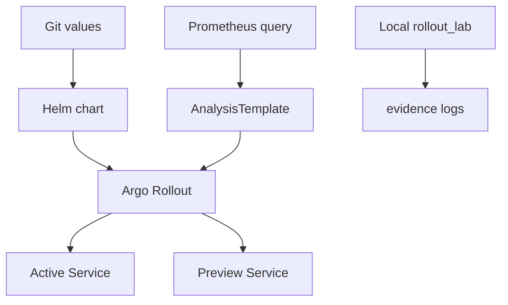

# Project 2 — Blue-green and canary delivery

This project has two layers.

1. A Helm chart with Argo Rollouts manifests for a blue-green strategy and a canary strategy.
2. A Python decision model that runs both strategies with healthy and failing inputs and writes a rollout log.

The Python model was executed locally. The Argo Rollouts chart was rendered with Helm. A live cluster rollout was not run, because Docker and kind are not installed on the machine used for this work. Do not call this a measured zero-downtime deployment.

## Samajh lo, Hinglish mein

Blue-green mein do copies hoti hain. Blue purana version hai, green naya. Users tab tak blue par rehte hain jab tak green ready na ho. Switch ek baar mein hota hai: active Service ka pointer green par chala jaata hai. Is chart mein `autoPromotionEnabled` false hai, matlab switch khud nahi hoga jab tak promotion allow na ho.

Canary mein naya version pehle thoda traffic leta hai: 10, phir 30, phir 50, phir 100 percent. Har step ke baad error ratio check hota hai. Agar error threshold se upar hai, aur failure limit cross ho gayi, to traffic wapas purane version par aata hai. Isi ko rollback kehte hain.

Local Python model yahi faisla karta hai. Woh cluster par packets nahi bhejta. Woh isliye hai taaki strategy bina AWS ke test ho sake.

## Architecture



## Difference

| Point | Blue-green | Canary |
| --- | --- | --- |
| Traffic | One controlled switch from active to preview | Weight steps of 10, 30, 50, and 100 |
| Risk window | Users stay on the old version until the switch | A small share of users hit the new version first |
| Rollback in the local model | Active version stays v1 when preview is unready or error ratio is high | Candidate weight returns to 0 after the failure limit |
| Extra cost | Two full copies exist around the switch | Old and new replicas share the same Rollout |

## Local test

From the repository root:

```bash
python3 -m pytest projects/02-progressive-delivery/rollout_lab/tests -q
python3 -m rollout_lab canary-success
python3 -m rollout_lab canary-failure
python3 -m rollout_lab blue-green-success
python3 -m rollout_lab blue-green-failure
helm lint projects/02-progressive-delivery/helm/demo-rollout
```

The module import needs the project directory on `PYTHONPATH`:

```bash
cd projects/02-progressive-delivery
PYTHONPATH=. python3 -m rollout_lab canary-failure
```

Evidence logs are written by the test `test_record_evidence_files` into `evidence/`. Those logs come from the local model, not from `kubectl argo rollouts get rollout`.

## Optional cluster install

Only after you have a cluster and you approve the install:

```bash
helm repo add argo https://argoproj.github.io/argo-helm
helm upgrade --install argo-rollouts argo/argo-rollouts \
  --namespace argo-rollouts --create-namespace
helm upgrade --install demo projects/02-progressive-delivery/helm/demo-rollout \
  -n demo --create-namespace \
  -f projects/02-progressive-delivery/helm/demo-rollout/values.yaml \
  -f projects/02-progressive-delivery/helm/demo-rollout/values-canary.yaml
```

The image repository is still `REPLACE_WITH_REGISTRY/demo-web`. A live install will not pull an image until that value changes. `values-canary-failure.yaml` sets `FAIL_READY` and `FAIL_API` so the candidate should fail readiness. That failure path was checked in the local model and in the rendered manifest. It was not checked on a cluster.

## Troubleshooting

| Symptom | Meaning |
| --- | --- |
| Local status is `paused` | Preview is healthy, and promotion was not requested. Active traffic is still on v1. |
| Local status is `rolled_back` | Readiness was false or the error ratio crossed 0.05 enough times. |
| Helm render fails on `subf` | Use the Helm 4 binary recorded in the root README. |
| Rollout CRD missing | Install the Argo Rollouts controller before applying the chart. |

## Teardown

```bash
helm uninstall demo -n demo
helm uninstall argo-rollouts -n argo-rollouts
```

Run that only on a cluster you created. It was not run here.

## Limitations

- No live traffic, no packet capture, and no measured downtime number.
- Rollback in `evidence/` is the Python model's decision, not an Argo controller event.
- EKS is optional and was not used.
- The success-rate query assumes Prometheus already scrapes `demo_http_requests_total`.
