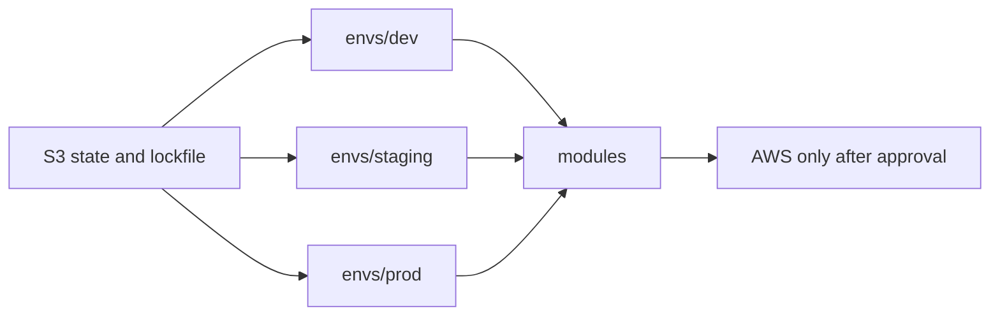

# Project 3 — Multi-environment Terraform

Reusable modules for networking, IAM, and compute sit under `modules/`. Dev, staging, and prod each have their own root module and `terraform.tfvars.json`. The modules do not contain environment names. The environment folders do.

`create_compute` is false in every committed environment. `terraform validate` checks the configuration. It does not create AWS resources.

## Samajh lo, Hinglish mein

Module ek reusable drawing hai. Environment us drawing ka form hai: dev ka network `10.50.0.0/16` hai, staging ka `10.60.0.0/16`, prod-style ka `10.70.0.0/16`. Prod-style config NAT gateway chahiye, lekin compute instances committed config mein band hain.

Remote state ka matlab Terraform ki yaad S3 bucket mein rakhi jaaye, laptop par nahi. Terraform 1.10 se S3 backend `use_lockfile = true` support karta hai. Lockfile ek object hai jo same time par do logon ko state likhne se rokta hai. Is repo ne real bucket par lock test nahi kiya.

State mein kabhi password mat daalo. Output simple IDs tak rakho. Bucket private ho, encryption on ho, aur versioning on ho taaki purani state wapas mil sake.

## Architecture



## Module contract

Networking inputs: `name`, `cidr`, `azs`, `public_subnet_cidrs`, `private_subnet_cidrs`, `enable_nat_gateway`, `tags`. Outputs: `vpc_id`, `public_subnet_ids`, `private_subnet_ids`.

IAM inputs: `name`, `create`, `tags`. Outputs: `instance_profile_name`, `role_arn`. The custom policy allows `ec2:DescribeInstances` and `ec2:DescribeTags` on `*` because those API actions do not support resource-level permissions. Log writes are limited to one log group ARN.

Compute inputs: `name`, `create`, `vpc_id`, `subnet_ids`, `instance_profile_name`, `instance_type`, `desired_capacity`, `tags`. Outputs: `security_group_id`, `autoscaling_group_name`. There is no SSH key and no inbound SSH rule. Instance metadata requires tokens.

## Local test

From the repository root:

```bash
python3 -m pytest projects/03-terraform-multi-environment/tests -q
python3 projects/03-terraform-multi-environment/policy/check_tags.py \
  projects/03-terraform-multi-environment/envs/*/terraform.tfvars.json
terraform fmt -check -recursive projects/03-terraform-multi-environment
for env in dev staging prod; do
  terraform -chdir=projects/03-terraform-multi-environment/envs/$env init -backend=false
  terraform -chdir=projects/03-terraform-multi-environment/envs/$env validate
done
```

The invalid fixture uses a number where a VPC CIDR string is required. Validation is expected to fail:

```bash
terraform -chdir=projects/03-terraform-multi-environment/tests/fixtures/invalid-syntax init -backend=false
terraform -chdir=projects/03-terraform-multi-environment/tests/fixtures/invalid-syntax validate
```

A non-zero exit from that second command is the successful detection.

## Remote state

Example partial config: `backend/backend.s3.hcl.example`.

```bash
cd projects/03-terraform-multi-environment/envs/dev
terraform init -backend-config=../../backend/backend.s3.hcl
```

Do that only after the bucket exists and you approve it. Recommended bucket controls, which are not created by this project:

- Block public access
- Versioning enabled
- SSE-KMS or SSE-S3
- IAM limited to the state prefix for each environment
- `use_lockfile = true`

Recovery: enable versioning, then restore the previous state object. Do not edit state by hand. If a lock object is stuck and you are sure no apply is running, Terraform's force-unlock needs the lock ID and a human decision. This was not tested.

## CI behavior

CI runs format, tag policy, and `terraform validate`. A bad tag file and the invalid HCL fixture must fail. `terraform apply` is not a CI job.

Checkov is listed in the root requirements and CI when the package imports. If it does not install on the current Python, the README verification section says so. tfsec is not used; its maintainers point users to Trivy, and Trivy is not installed here.

## Teardown

If you later apply an environment, destroy only that environment after approval:

```bash
terraform -chdir=projects/03-terraform-multi-environment/envs/dev destroy
```

## Limitations

- No AWS account was used.
- S3 locking was not executed.
- Prod NAT is a configuration choice in `terraform.tfvars.json`. It was not created.
- `ec2:Describe*` remains on `*` inside the optional instance policy.
